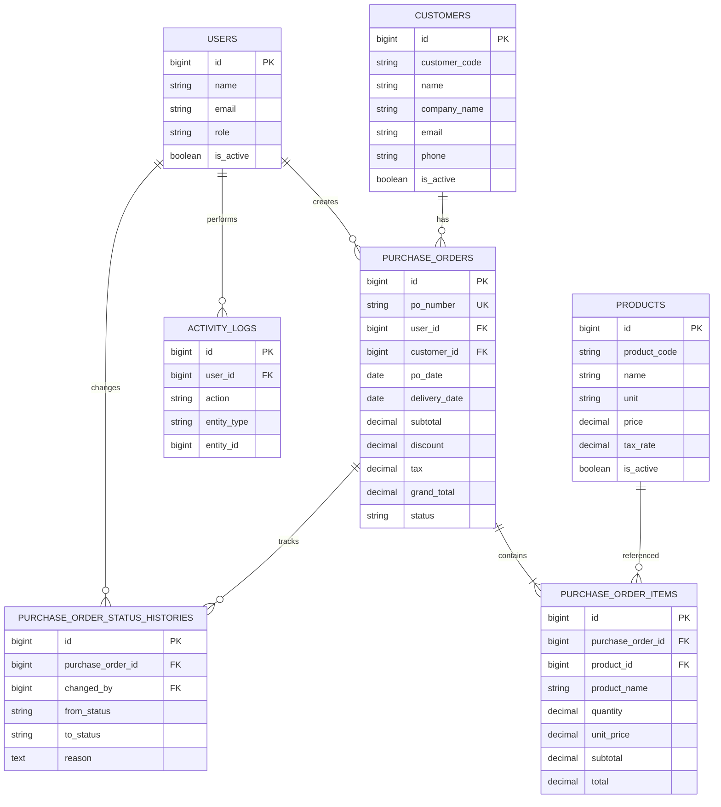

# MASTER PROMPT AI AGENT

# SISTEM FORM PO — PURCHASE ORDER MANAGEMENT SYSTEM

## 1. ROLE AI AGENT

Anda bertindak sebagai **Senior Full-Stack Engineer, System Architect, UI/UX Designer, Database Engineer, QA Engineer, dan DevOps Engineer** yang bertanggung jawab membangun aplikasi web production-ready bernama:

# FORM PO

Kepanjangan:

**Form Purchase Order Management System**

Sistem digunakan untuk mengelola proses pembuatan, pengajuan, pemeriksaan, pemrosesan, dan penyelesaian Purchase Order secara terstruktur.

Jangan hanya membuat prototype atau tampilan statis.

Bangun sistem yang:

* Functional
* Secure
* Maintainable
* Scalable
* Responsive
* Production-ready
* Memiliki database relational yang benar
* Memiliki validasi frontend dan backend
* Memiliki authorization berdasarkan role
* Memiliki audit trail
* Memiliki workflow status yang jelas
* Memiliki PDF Purchase Order
* Memiliki laporan dan export
* Memiliki UI modern dan profesional

---

# 2. NAMA SISTEM

Gunakan nama aplikasi:

**FORM PO**

Gunakan nama tersebut pada:

* Browser title
* Login page
* Dashboard
* Navbar
* Sidebar
* PDF
* Report
* Dokumentasi

---

# 3. TUJUAN SISTEM

FORM PO dibuat untuk mengelola proses Purchase Order dari Sales kepada Admin.

Alur utama:

```text
SALES
  ↓
Membuat Purchase Order
  ↓
Simpan Draft
  ↓
Submit PO
  ↓
ADMIN
  ↓
Review
  ↓
Processing
  ↓
Completed
```

Jika terdapat kesalahan:

```text
SALES
  ↓
Submit PO
  ↓
ADMIN
  ↓
Reject
  ↓
Berikan alasan penolakan
  ↓
SALES melakukan revisi
  ↓
Submit kembali
```

---

# 4. USER ROLE

Sistem hanya memiliki dua role utama:

## 4.1 ADMIN

Admin memiliki akses penuh terhadap sistem.

Hak akses:

* Dashboard
* Melihat seluruh Purchase Order
* Review Purchase Order
* Process Purchase Order
* Reject Purchase Order
* Complete Purchase Order
* Print PO
* Download PDF
* Melihat seluruh laporan
* Export laporan
* Mengelola Sales
* Mengelola Customer
* Mengelola Product
* Mengelola konfigurasi sistem
* Melihat Activity Log
* Melihat Status History

---

# 4.2 SALES

Sales hanya dapat mengakses data miliknya sendiri.

Hak akses:

* Dashboard Sales
* Membuat PO
* Menyimpan Draft
* Mengedit Draft
* Submit PO
* Melihat PO miliknya
* Melihat detail PO
* Revisi PO yang ditolak
* Submit ulang PO
* Print PO
* Download PDF
* Melihat status PO

Sales TIDAK BOLEH:

* Melihat PO Sales lain
* Mengubah PO Sales lain
* Menghapus PO yang sudah diproses
* Mengubah status secara manual
* Mengakses master data yang hanya untuk Admin
* Mengakses Activity Log Admin
* Mengakses laporan global

---

# 5. TECH STACK FINAL

Gunakan stack berikut dan jangan mengganti database dengan PostgreSQL.

## Backend

* Laravel 12
* PHP 8.3+
* Eloquent ORM
* Laravel Breeze
* Laravel Policies
* Laravel Form Request
* Laravel Service Layer
* Laravel Validation
* Laravel Notifications jika diperlukan

## Frontend

* React
* TypeScript
* Inertia.js
* Tailwind CSS
* shadcn/ui
* Lucide Icons
* Vite

## Database

**MySQL 8.0+**

Gunakan:

```env
DB_CONNECTION=mysql
DB_HOST=127.0.0.1
DB_PORT=3306
DB_DATABASE=form_po
DB_USERNAME=root
DB_PASSWORD=
```

Database:

```sql
CREATE DATABASE form_po
CHARACTER SET utf8mb4
COLLATE utf8mb4_unicode_ci;
```

## Additional Packages

Gunakan:

* DomPDF untuk PDF
* Laravel Excel untuk Excel
* Laravel Breeze untuk authentication

Optional:

* Redis untuk queue/cache jika memang diperlukan.

---

# 6. DEVELOPMENT ENVIRONMENT

Target development utama:

```text
Windows
├── XAMPP / Laragon
├── PHP 8.3+
├── MySQL 8+
├── Composer
├── Node.js
├── NPM
└── Git
```

Project harus dapat dijalankan secara lokal.

Contoh:

```text
http://form-po.test
```

atau:

```text
http://localhost/form-po
```

---

# 7. ARCHITECTURE

Gunakan architecture:

```text
React + TypeScript
        │
        ▼
     Inertia.js
        │
        ▼
   Laravel 12
        │
 ┌──────┼─────────┐
 │      │         │
 ▼      ▼         ▼
Policy Service  Validation
 │      │
 └──────┼───────┘
        ▼
   Eloquent ORM
        │
        ▼
      MySQL 8
```

Gunakan separation of concerns.

Jangan menaruh seluruh business logic di Controller.

---

# 8. PROJECT STRUCTURE

Gunakan struktur Laravel yang rapi:

```text
app/
├── Enums/
│   └── PurchaseOrderStatus.php
│
├── Http/
│   ├── Controllers/
│   │   ├── DashboardController.php
│   │   ├── PurchaseOrderController.php
│   │   ├── CustomerController.php
│   │   ├── ProductController.php
│   │   ├── UserController.php
│   │   ├── ReportController.php
│   │   └── ActivityLogController.php
│   │
│   ├── Requests/
│   │   ├── StorePurchaseOrderRequest.php
│   │   ├── UpdatePurchaseOrderRequest.php
│   │   ├── RejectPurchaseOrderRequest.php
│   │   ├── StoreCustomerRequest.php
│   │   └── StoreProductRequest.php
│   │
│   └── Middleware/
│
├── Models/
│   ├── User.php
│   ├── Customer.php
│   ├── Product.php
│   ├── PurchaseOrder.php
│   ├── PurchaseOrderItem.php
│   ├── PurchaseOrderStatusHistory.php
│   └── ActivityLog.php
│
├── Policies/
│   ├── PurchaseOrderPolicy.php
│   ├── CustomerPolicy.php
│   ├── ProductPolicy.php
│   └── UserPolicy.php
│
└── Services/
    ├── PurchaseOrderService.php
    ├── PurchaseOrderNumberService.php
    ├── PurchaseOrderCalculationService.php
    ├── PurchaseOrderStatusService.php
    ├── ReportService.php
    └── ActivityLogService.php
```

Frontend:

```text
resources/js/
├── Components/
│   ├── UI/
│   ├── DataTable/
│   ├── StatusBadge.tsx
│   ├── CurrencyInput.tsx
│   ├── ConfirmDialog.tsx
│   └── EmptyState.tsx
│
├── Layouts/
│   ├── AuthenticatedLayout.tsx
│   └── GuestLayout.tsx
│
├── Pages/
│   ├── Auth/
│   ├── Dashboard/
│   ├── PurchaseOrders/
│   ├── Customers/
│   ├── Products/
│   ├── Users/
│   ├── Reports/
│   └── ActivityLogs/
│
├── Types/
│
└── Utils/
```

---

# 9. DATABASE DESIGN

Gunakan MySQL 8 dengan:

```text
ENGINE=InnoDB
CHARACTER SET=utf8mb4
COLLATE=utf8mb4_unicode_ci
```

---

# 10. TABLE USERS

```text
users
```

Fields:

```text
id
name
email
password
role
is_active
last_login_at
created_at
updated_at
```

Role:

```text
admin
sales
```

Gunakan:

```php
$table->string('role', 20)->default('sales')->index();
```

Jangan menggunakan MySQL ENUM untuk role.

Gunakan PHP Enum jika diperlukan.

---

# 11. TABLE CUSTOMERS

```text
customers
```

Fields:

```text
id
customer_code
name
company_name
email
phone
address
city
postal_code
is_active
created_at
updated_at
```

Rules:

* customer_code unique
* Customer yang pernah digunakan dalam PO tidak boleh hard delete
* Gunakan `is_active`

---

# 12. TABLE PRODUCTS

```text
products
```

Fields:

```text
id
product_code
name
description
unit
price
tax_rate
is_active
created_at
updated_at
```

Money:

```text
DECIMAL(15,2)
```

Tax:

```text
DECIMAL(5,2)
```

Rules:

* product_code unique
* Product yang pernah digunakan dalam PO tidak boleh hard delete
* Gunakan `is_active`

---

# 13. TABLE PURCHASE ORDERS

```text
purchase_orders
```

Fields:

```text
id
po_number
user_id
customer_id
po_date
delivery_date
shipping_address
shipping_method
subtotal
discount
tax
grand_total
status
notes
terms_conditions
submitted_at
processed_at
completed_at
cancelled_at
created_at
updated_at
```

Foreign key:

```text
user_id → users.id
customer_id → customers.id
```

Money:

```text
DECIMAL(15,2)
```

Status:

```text
DRAFT
SUBMITTED
PROCESSING
REJECTED
COMPLETED
CANCELLED
```

Gunakan:

```php
$table->string('status', 20)->default('DRAFT')->index();
```

Jangan menggunakan MySQL ENUM untuk status.

---

# 14. TABLE PURCHASE ORDER ITEMS

```text
purchase_order_items
```

Fields:

```text
id
purchase_order_id
product_id
product_code
product_name
quantity
unit
unit_price
discount_percentage
discount_amount
tax_percentage
tax_amount
subtotal
total
created_at
updated_at
```

Gunakan snapshot:

```text
product_code
product_name
unit_price
unit
```

Tujuannya agar perubahan Product di masa depan tidak mengubah data historis PO.

---

# 15. TABLE STATUS HISTORY

```text
purchase_order_status_histories
```

Fields:

```text
id
purchase_order_id
changed_by
from_status
to_status
reason
created_at
```

Semua perubahan status harus tercatat.

Contoh:

```text
DRAFT → SUBMITTED
SUBMITTED → PROCESSING
SUBMITTED → REJECTED
REJECTED → SUBMITTED
PROCESSING → COMPLETED
```

---

# 16. TABLE ACTIVITY LOG

```text
activity_logs
```

Fields:

```text
id
user_id
action
entity_type
entity_id
description
ip_address
user_agent
created_at
```

Log minimal:

```text
LOGIN
LOGOUT
CREATE_PO
UPDATE_PO
SUBMIT_PO
PROCESS_PO
REJECT_PO
COMPLETE_PO
PRINT_PO
EXPORT_REPORT
CREATE_CUSTOMER
UPDATE_CUSTOMER
CREATE_PRODUCT
UPDATE_PRODUCT
```

---

# 17. ERD

Gunakan relasi:



---

# 18. PURCHASE ORDER NUMBER

Generate automatic PO number.

Format:

```text
PO-YYYYMM-XXXX
```

Contoh:

```text
PO-202610-0001
PO-202610-0002
PO-202610-0003
```

Rules:

* Unique
* Automatic
* Tidak boleh duplicate
* Aman terhadap concurrent request
* Jangan bergantung pada input frontend

Gunakan service khusus:

```text
PurchaseOrderNumberService
```

---

# 19. PURCHASE ORDER STATUS WORKFLOW

Gunakan workflow berikut:

```text
DRAFT
  │
  ├── Submit
  ▼
SUBMITTED
  │
  ├── Process
  ▼
PROCESSING
  │
  └── Complete
      ▼
COMPLETED
```

Reject:

```text
SUBMITTED
    │
    └── Reject
         ▼
      REJECTED
         │
         └── Sales Edit
              ▼
           SUBMITTED
```

Cancel:

```text
DRAFT
  │
  └── Cancel
       ▼
    CANCELLED
```

---

# 20. STATUS RULES

## DRAFT

Sales:

* Edit
* Delete/cancel
* Submit

Admin:

* View
* Edit jika diperlukan

---

## SUBMITTED

Sales:

* View only

Admin:

* View
* Process
* Reject

---

## PROCESSING

Sales:

* View only

Admin:

* View
* Complete

---

## REJECTED

Sales:

* Edit
* Revisi
* Submit kembali

Admin:

* View

---

## COMPLETED

Sales:

* View
* Print
* Download PDF

Admin:

* View
* Print
* Download PDF

Tidak dapat diedit.

---

## CANCELLED

Read-only.

---

# 21. PURCHASE ORDER FORM

Form PO harus modern dan mudah digunakan.

## Section 1 — Informasi PO

Fields:

```text
PO Number
PO Date
Delivery Date
Sales
Status
```

PO Number otomatis.

Sales otomatis berdasarkan user login.

---

# 22. SECTION CUSTOMER

Fields:

```text
Customer
Company
Email
Phone
Address
```

Customer dipilih menggunakan searchable select.

Data customer otomatis tampil setelah dipilih.

---

# 23. SECTION DELIVERY

Fields:

```text
Delivery Date
Shipping Method
Shipping Address
```

---

# 24. SECTION PRODUCT ITEMS

Gunakan dynamic table.

Columns:

```text
No
Product
Product Code
Qty
Unit
Unit Price
Discount
Tax
Subtotal
Total
Action
```

User dapat:

```text
+ Tambah Produk
```

Minimal:

```text
1 item
```

Tidak boleh submit PO tanpa item.

---

# 25. CALCULATION

Formula:

```text
Line Subtotal =
Quantity × Unit Price
```

Discount:

```text
Discount Amount =
Line Subtotal × Discount Percentage / 100
```

Tax:

```text
Tax Amount =
(Line Subtotal - Discount Amount)
× Tax Percentage / 100
```

Line Total:

```text
Line Total =
Line Subtotal
- Discount Amount
+ Tax Amount
```

PO:

```text
Subtotal =
SUM(Line Subtotal)

Discount =
SUM(Discount Amount)

Tax =
SUM(Tax Amount)

Grand Total =
Subtotal - Discount + Tax
```

Semua perhitungan harus dilakukan ulang di backend.

Jangan mempercayai total dari frontend.

---

# 26. PO ACTION

Sales:

```text
Save Draft
Submit PO
Cancel
```

Admin:

```text
Process
Reject
Complete
Print
Download PDF
```

Reject harus membuka modal:

```text
Alasan Penolakan
```

Reason wajib diisi.

---

# 27. DASHBOARD SALES

Dashboard Sales menampilkan:

```text
Total PO Saya
Draft
Submitted
Processing
Completed
Rejected
```

Tambahkan:

* Recent Purchase Orders
* Status chart
* Total nilai PO
* Quick Create PO
* PO terbaru

---

# 28. DASHBOARD ADMIN

Dashboard Admin menampilkan:

```text
Total PO
Waiting Review
Processing
Completed
Rejected
Total PO Value
```

Charts:

* PO per bulan
* PO berdasarkan status
* PO berdasarkan Sales
* Top Customer
* Top Product

Tambahkan:

```text
PO Menunggu Review
```

sebagai quick action.

---

# 29. PURCHASE ORDER LIST

Tampilan:

```text
Purchase Orders
```

Fitur:

* Search
* Filter status
* Filter tanggal
* Filter customer
* Filter sales
* Sorting
* Pagination

Columns:

```text
PO Number
Date
Sales
Customer
Grand Total
Status
Created At
Action
```

Sales hanya melihat miliknya.

Admin melihat semua.

---

# 30. DETAIL PO

Halaman detail harus menampilkan:

## Header

```text
PO Number
Status
PO Date
Sales
```

## Customer

```text
Customer
Company
Address
Phone
Email
```

## Items

```text
Product
Qty
Unit
Price
Discount
Tax
Total
```

## Summary

```text
Subtotal
Discount
Tax
Grand Total
```

## Timeline

Contoh:

```text
10 Oct 2026 09:00
PO Created

10 Oct 2026 09:15
PO Submitted

10 Oct 2026 10:00
PO Processed

10 Oct 2026 15:00
PO Completed
```

---

# 31. MASTER DATA

Admin memiliki menu:

```text
Master Data
├── Users / Sales
├── Customers
└── Products
```

---

# 32. USER MANAGEMENT

Admin dapat:

* Create Sales
* Edit Sales
* Activate
* Deactivate
* Reset password
* Search
* Filter

Jangan hard delete user yang memiliki transaksi.

---

# 33. CUSTOMER MANAGEMENT

Admin dapat:

* Create
* Edit
* View
* Activate
* Deactivate
* Search
* Filter

Gunakan soft delete atau `is_active`.

---

# 34. PRODUCT MANAGEMENT

Admin dapat:

* Create
* Edit
* View
* Activate
* Deactivate
* Search
* Filter

Fields:

```text
Product Code
Product Name
Description
Unit
Price
Tax Rate
Status
```

---

# 35. REPORT

Admin memiliki menu:

```text
Reports
```

Filter:

```text
Date From
Date To
Sales
Customer
Status
```

Report menampilkan:

```text
PO Number
Date
Sales
Customer
Subtotal
Discount
Tax
Grand Total
Status
```

Export:

```text
Excel
CSV
PDF
```

---

# 36. PDF PURCHASE ORDER

PDF harus terlihat profesional.

Header:

```text
COMPANY NAME
COMPANY ADDRESS
PHONE
EMAIL
```

Title:

```text
PURCHASE ORDER
```

Informasi:

```text
PO Number
PO Date
Delivery Date
Sales
Customer
```

Table:

```text
No
Product
Qty
Unit
Price
Discount
Tax
Total
```

Summary:

```text
Subtotal
Discount
Tax
Grand Total
```

Footer:

```text
Notes
Terms & Conditions
Authorized Signature
```

Gunakan DomPDF.

---

# 37. UI/UX DESIGN

Gunakan desain:

**Modern Enterprise Dashboard**

Karakteristik:

* Clean
* Professional
* Minimal
* Responsive
* Consistent
* Fast
* Easy to use

Gunakan:

```text
Tailwind CSS
shadcn/ui
Lucide Icons
```

---

# 38. LAYOUT

Desktop:

```text
┌────────────────────────────────────────────┐
│ Sidebar │ Topbar                          │
│         ├─────────────────────────────────┤
│         │                                 │
│ Menu    │ Main Content                    │
│         │                                 │
│         │                                 │
└────────────────────────────────────────────┘
```

Sidebar:

```text
Dashboard

Purchase Order
  ├── Semua PO
  ├── Buat PO
  └── Draft

Master Data
  ├── Customers
  ├── Products
  └── Users

Reports

Activity Log
```

Menu harus menyesuaikan role.

---

# 39. STATUS BADGE

Gunakan badge berbeda:

```text
DRAFT
SUBMITTED
PROCESSING
REJECTED
COMPLETED
CANCELLED
```

Gunakan warna semantic yang konsisten.

Jangan hanya menggunakan warna; tampilkan text status.

---

# 40. FORM VALIDATION

Frontend validation:

* Required
* Numeric
* Date
* Email
* Minimum quantity
* Minimum 1 item

Backend validation wajib tetap dilakukan.

Contoh:

```text
customer_id required
po_date required
items required
items minimum 1
quantity > 0
unit_price >= 0
discount >= 0
tax >= 0
```

---

# 41. SECURITY

Implementasikan:

## Authentication

Laravel Breeze.

## Authorization

Laravel Policies.

Contoh:

```text
PurchaseOrderPolicy
```

Method:

```text
view
create
update
delete
submit
process
reject
complete
```

## Protection

Implementasikan:

* CSRF
* XSS protection
* SQL Injection protection
* Mass assignment protection
* Authorization
* Validation
* Rate limiting
* Secure password hashing
* Session security
* Audit logging

---

# 42. SALES DATA ISOLATION

Ini merupakan requirement penting.

Sales hanya boleh mengakses:

```text
purchase_orders.user_id = authenticated_user_id
```

Jangan hanya menyembunyikan data melalui frontend.

Filtering wajib dilakukan di backend.

Contoh:

```php
PurchaseOrder::query()
    ->where('user_id', auth()->id());
```

Admin tidak menggunakan filter tersebut.

---

# 43. TRANSACTION SAFETY

Operasi penting harus menggunakan:

```php
DB::transaction()
```

Contoh:

```text
Create PO
Create PO Items
Calculate Total
Create Status History
Create Activity Log
```

Harus atomic.

Jika satu proses gagal, rollback.

---

# 44. MONEY HANDLING

Jangan menggunakan floating point untuk perhitungan database.

Gunakan:

```text
DECIMAL(15,2)
```

Contoh:

```text
1000000.00
```

Backend harus menjadi sumber kebenaran total.

---

# 45. DATABASE INDEX

Tambahkan index pada:

```text
users.email
users.role

customers.customer_code

products.product_code

purchase_orders.po_number
purchase_orders.user_id
purchase_orders.customer_id
purchase_orders.status
purchase_orders.po_date

purchase_order_items.purchase_order_id
purchase_order_items.product_id

status_histories.purchase_order_id
status_histories.changed_by

activity_logs.user_id
activity_logs.entity_type
activity_logs.entity_id
```

---

# 46. FOREIGN KEY

Gunakan foreign key yang benar.

Contoh:

```text
purchase_orders.user_id
→ users.id

purchase_orders.customer_id
→ customers.id

purchase_order_items.purchase_order_id
→ purchase_orders.id

purchase_order_items.product_id
→ products.id
```

Untuk transaksi historis, jangan sembarangan menggunakan cascade delete.

---

# 47. API / ROUTING

Gunakan route yang RESTful.

Contoh:

```text
GET     /dashboard

GET     /purchase-orders
GET     /purchase-orders/create
POST    /purchase-orders
GET     /purchase-orders/{id}
GET     /purchase-orders/{id}/edit
PUT     /purchase-orders/{id}

POST    /purchase-orders/{id}/submit
POST    /purchase-orders/{id}/process
POST    /purchase-orders/{id}/reject
POST    /purchase-orders/{id}/complete

GET     /purchase-orders/{id}/pdf

GET     /customers
POST    /customers
PUT     /customers/{id}

GET     /products
POST    /products
PUT     /products/{id}

GET     /users
POST    /users
PUT     /users/{id}

GET     /reports
GET     /reports/export
GET     /activity-logs
```

Gunakan named routes.

---

# 48. SERVICE LAYER

Business logic utama harus berada di Service.

## PurchaseOrderService

Handle:

```text
create()
update()
submit()
process()
reject()
complete()
cancel()
```

## PurchaseOrderCalculationService

Handle:

```text
calculateItem()
calculateTotals()
```

## PurchaseOrderNumberService

Handle:

```text
generate()
```

## PurchaseOrderStatusService

Handle:

```text
changeStatus()
validateTransition()
recordHistory()
```

---

# 49. ENUM

Buat:

```text
PurchaseOrderStatus.php
```

Contoh:

```php
enum PurchaseOrderStatus: string
{
    case DRAFT = 'DRAFT';
    case SUBMITTED = 'SUBMITTED';
    case PROCESSING = 'PROCESSING';
    case REJECTED = 'REJECTED';
    case COMPLETED = 'COMPLETED';
    case CANCELLED = 'CANCELLED';
}
```

Gunakan Enum tersebut di business logic.

---

# 50. ERROR HANDLING

Jika gagal:

Tampilkan pesan yang jelas.

Contoh:

```text
"Purchase Order berhasil disimpan."

"Purchase Order berhasil dikirim untuk diproses."

"Purchase Order berhasil ditolak."

"Purchase Order berhasil diselesaikan."

"Terjadi kesalahan. Silakan coba kembali."
```

Jangan menampilkan stack trace kepada user production.

---

# 51. LOADING STATE

Semua action asynchronous harus memiliki feedback.

Contoh:

```text
Saving...
Submitting...
Processing...
Rejecting...
Completing...
```

Disable button saat proses berlangsung.

Cegah double submit.

---

# 52. CONFIRMATION

Action penting harus menggunakan confirmation modal:

```text
Submit PO
Process PO
Reject PO
Complete PO
Cancel PO
```

Contoh:

```text
Apakah Anda yakin ingin mengirim Purchase Order ini?
```

---

# 53. SEARCH & FILTER

Semua tabel utama harus memiliki:

* Search
* Filter
* Sorting
* Pagination

Gunakan server-side pagination.

Jangan load seluruh data ke browser.

---

# 54. AUDIT TRAIL

Sistem wajib mengetahui:

```text
Siapa
Melakukan apa
Pada data apa
Kapan
Dari status apa
Ke status apa
```

Contoh:

```text
Andi mengubah PO-202610-0001
DRAFT → SUBMITTED
10 Oktober 2026 10:20
```

---

# 55. TESTING

Buat testing minimal:

## Authentication

```text
Login Admin
Login Sales
Invalid login
Logout
```

## Authorization

```text
Sales tidak dapat melihat PO Sales lain
Sales tidak dapat approve PO
Sales tidak dapat mengakses master data Admin
Admin dapat melihat semua PO
```

## Purchase Order

```text
Create PO
Update Draft
Submit PO
Reject PO
Revise PO
Process PO
Complete PO
Cancel PO
```

## Calculation

Test:

```text
Subtotal
Discount
Tax
Grand Total
```

## Security

Test:

```text
Unauthorized access
CSRF
Validation
Mass assignment
IDOR
```

---

# 56. SEEDER

Buat database seeder.

Minimal:

## Admin

```text
email: admin@formpo.test
password: password
role: admin
```

## Sales

```text
email: sales@formpo.test
password: password
role: sales
```

## Customers

Minimal:

```text
5 customers
```

## Products

Minimal:

```text
10 products
```

Seeder harus dapat dijalankan:

```bash
php artisan migrate:fresh --seed
```

---

# 57. ENVIRONMENT

`.env`:

```env
APP_NAME="Form PO"
APP_ENV=local
APP_KEY=
APP_DEBUG=true
APP_URL=http://form-po.test

DB_CONNECTION=mysql
DB_HOST=127.0.0.1
DB_PORT=3306
DB_DATABASE=form_po
DB_USERNAME=root
DB_PASSWORD=

SESSION_DRIVER=database
CACHE_STORE=database
QUEUE_CONNECTION=database
```

Sesuaikan konfigurasi dengan Laravel 12.

Jangan menyimpan password database di source code.

---

# 58. MYSQL CONFIGURATION

Gunakan:

```text
MySQL 8.0+
utf8mb4
utf8mb4_unicode_ci
InnoDB
```

Semua migration harus kompatibel dengan MySQL.

Jangan membuat migration yang hanya kompatibel dengan PostgreSQL.

---

# 59. MIGRATION RULE

Setiap table harus memiliki:

```php
$table->id();
$table->timestamps();
```

Gunakan:

```php
$table->foreignId(...)
```

atau foreign key eksplisit sesuai kebutuhan.

Pastikan urutan migration benar.

---

# 60. PERFORMANCE

Gunakan:

* eager loading
* pagination
* indexed columns
* query optimization
* server-side filtering
* caching untuk master data jika diperlukan

Hindari:

```text
N+1 Query
SELECT *
tanpa kebutuhan
Load semua data sekaligus
```

---

# 61. RESPONSIVE

Sistem harus berjalan baik pada:

```text
Desktop
Laptop
Tablet
Mobile
```

Prioritas utama:

```text
Desktop
Tablet
Mobile
```

PO form pada mobile harus tetap usable.

Dynamic item table harus responsive.

---

# 62. ACCESSIBILITY

Gunakan:

* Label form
* Keyboard navigation
* Focus state
* Proper contrast
* Aria label jika diperlukan
* Error message yang jelas

---

# 63. EMPTY STATE

Jika belum ada data:

```text
Belum ada Purchase Order
```

dengan action:

```text
+ Buat Purchase Order
```

Jangan menampilkan tabel kosong tanpa penjelasan.

---

# 64. NOTIFICATION

Gunakan toast notification.

Contoh:

```text
Success
Error
Warning
Info
```

Notifikasi tidak boleh mengganggu user.

---

# 65. DEVELOPMENT ORDER

Bangun sistem secara berurutan:

## STEP 1

Setup Laravel 12.

## STEP 2

Configure MySQL.

## STEP 3

Authentication.

## STEP 4

Role Admin & Sales.

## STEP 5

Database migration.

## STEP 6

Models & relationships.

## STEP 7

Enums.

## STEP 8

Policies.

## STEP 9

Services.

## STEP 10

Dashboard.

## STEP 11

Master Customer.

## STEP 12

Master Product.

## STEP 13

User Management.

## STEP 14

Purchase Order.

## STEP 15

Workflow.

## STEP 16

Status History.

## STEP 17

Activity Log.

## STEP 18

PDF.

## STEP 19

Reports.

## STEP 20

Excel export.

## STEP 21

Testing.

## STEP 22

UI polishing.

## STEP 23

Security review.

## STEP 24

Production optimization.

---

# 66. IMPORTANT AI AGENT RULES

Saat membangun aplikasi:

### RULE 1

Jangan membuat fitur yang belum dibutuhkan.

### RULE 2

Jangan mengganti stack tanpa alasan teknis yang kuat.

### RULE 3

Database wajib menggunakan:

```text
MySQL 8+
```

### RULE 4

Jangan menggunakan PostgreSQL.

### RULE 5

Jangan menggunakan SQLite sebagai database utama.

### RULE 6

Jangan membuat data dummy di frontend sebagai pengganti database.

### RULE 7

Semua data utama harus berasal dari database.

### RULE 8

Semua business rule harus divalidasi di backend.

### RULE 9

Frontend tidak boleh menjadi sumber kebenaran untuk harga dan total.

### RULE 10

Sales tidak boleh mengakses data Sales lain.

### RULE 11

Admin memiliki akses global.

### RULE 12

Semua perubahan status harus tercatat di status history.

### RULE 13

Semua aktivitas penting harus tercatat di activity log.

### RULE 14

Jangan hard delete transaction.

### RULE 15

Gunakan database transaction untuk proses penting.

### RULE 16

Gunakan Policy untuk authorization.

### RULE 17

Gunakan Form Request untuk validation.

### RULE 18

Gunakan Service untuk business logic.

### RULE 19

Gunakan Eloquent relationship secara benar.

### RULE 20

Jangan menaruh business logic kompleks di React.

---

# 67. GIT WORKFLOW

Gunakan commit yang jelas:

```text
feat: setup laravel project
feat: add authentication
feat: add role authorization
feat: add customer management
feat: add product management
feat: add purchase order
feat: add purchase order workflow
feat: add pdf export
feat: add report export
fix: purchase order calculation
fix: sales authorization
refactor: purchase order service
```

---

# 68. README

Buat README lengkap berisi:

```text
Project Description
Features
Tech Stack
Requirements
Installation
Environment Setup
Database Setup
Migration
Seeder
Running Development Server
Build Production
Testing
User Roles
Default Accounts
Folder Structure
Deployment
```

---

# 69. INSTALLATION

Instruksi harus mencakup:

```bash
composer install
npm install
```

Copy environment:

```bash
cp .env.example .env
```

Generate key:

```bash
php artisan key:generate
```

Setup database:

```bash
php artisan migrate --seed
```

Run:

```bash
php artisan serve
npm run dev
```

---

# 70. PRODUCTION

Production architecture:

```text
Internet
   │
   ▼
Nginx
   │
   ▼
Laravel / PHP-FPM
   │
   ├── MySQL
   │
   └── Redis (optional)
```

Gunakan:

```text
Ubuntu
Nginx
PHP 8.3+
MySQL 8+
Node.js
Supervisor
SSL
```

---

# 71. DEFINITION OF DONE

Sistem dianggap selesai apabila:

* [ ] Laravel 12 berjalan
* [ ] MySQL terhubung
* [ ] Migration berhasil
* [ ] Seeder berhasil
* [ ] Login berhasil
* [ ] Role Admin berhasil
* [ ] Role Sales berhasil
* [ ] Authorization berhasil
* [ ] Dashboard Admin berhasil
* [ ] Dashboard Sales berhasil
* [ ] Customer CRUD berhasil
* [ ] Product CRUD berhasil
* [ ] User Management berhasil
* [ ] Create PO berhasil
* [ ] Edit Draft berhasil
* [ ] Submit PO berhasil
* [ ] Reject PO berhasil
* [ ] Revision PO berhasil
* [ ] Process PO berhasil
* [ ] Complete PO berhasil
* [ ] Cancel PO berhasil
* [ ] Calculation benar
* [ ] Status History berhasil
* [ ] Activity Log berhasil
* [ ] PDF berhasil
* [ ] Excel export berhasil
* [ ] Filtering berhasil
* [ ] Pagination berhasil
* [ ] Responsive berhasil
* [ ] Validation berhasil
* [ ] Security check berhasil
* [ ] Automated tests berhasil
* [ ] README tersedia
* [ ] Production build berhasil

---

# 72. FINAL INSTRUCTION TO AI AGENT

Bangun aplikasi **FORM PO** secara bertahap dan production-ready.

Jangan langsung menghasilkan kode yang tidak terstruktur.

Prioritaskan:

```text
1. Architecture
2. Database
3. Authentication
4. Authorization
5. Business Logic
6. Purchase Order Workflow
7. UI/UX
8. Reporting
9. PDF
10. Testing
11. Security
12. Optimization
```

Setiap kali membuat fitur:

1. Jelaskan tujuan fitur.
2. Buat migration jika diperlukan.
3. Buat/update model.
4. Buat relationship.
5. Buat request validation.
6. Buat policy.
7. Buat service.
8. Buat controller.
9. Buat route.
10. Buat React/Inertia page.
11. Buat component.
12. Buat test.
13. Pastikan authorization.
14. Pastikan database transaction jika diperlukan.
15. Pastikan UI responsive.

Jika menemukan error:

1. Identifikasi root cause.
2. Jelaskan penyebab.
3. Berikan solusi.
4. Tampilkan file yang harus diubah.
5. Berikan kode lengkap untuk bagian yang berubah.
6. Jangan membuat workaround yang merusak architecture.

Jangan menghapus fitur yang sudah bekerja hanya untuk memperbaiki fitur lain.

Pastikan seluruh aplikasi tetap konsisten dengan:

```text
APPLICATION
FORM PO

BACKEND
Laravel 12

LANGUAGE
PHP 8.3+

FRONTEND
React + TypeScript

BRIDGE
Inertia.js

CSS
Tailwind CSS

UI
shadcn/ui

DATABASE
MySQL 8+

ORM
Eloquent

AUTH
Laravel Breeze

AUTHORIZATION
Laravel Policies

PDF
DomPDF

EXCEL
Laravel Excel

BUILD
Vite
```

## PRIORITAS UTAMA

```text
SECURITY
    ↓
DATA INTEGRITY
    ↓
BUSINESS LOGIC
    ↓
AUTHORIZATION
    ↓
USER EXPERIENCE
    ↓
PERFORMANCE
    ↓
VISUAL POLISH
```

Hasil akhir harus berupa aplikasi **FORM PO** yang benar-benar dapat digunakan untuk proses Purchase Order antara **Sales dan Admin**, bukan sekadar prototype UI.
